## Bloque 5 · Perfiles y administración (Integrante C)

**Rama:** `feature/profiles-admin`

### Objetivo
Exponer los perfiles de usuario y un listado de administración, cuidando que los datos de contacto (correo y teléfono) solo los vean quienes deben.

### Qué se implementó

| Requisito | Implementación |
|---|---|
| `GET /api/v1/usuarios/me` | Devuelve los datos del usuario autenticado, incluido su contacto. El usuario se identifica por el correo guardado en el token JWT. |
| `GET /api/v1/trabajadores` y `/{id}` | Usan `PerfilPublico`: `id`, `nombre`, `oficioPrincipal`, `zona`. **No** incluyen correo ni teléfono. Solo listan usuarios con rol `TRABAJADOR`. Un id inexistente o de otro rol responde 404. |
| `GET /api/v1/admin/usuarios` | Usa `PerfilAdmin`, que sí incluye `correo` y `telefono`. Protegido por URL en `SecurityConfig` y por `@PreAuthorize("hasRole('ADMIN')")`. |
| ADMIN al arrancar | `AdminSeeder` crea el administrador solo con el perfil `dev`. Es idempotente: si el correo ya existe, no lo duplica. Las credenciales salen de `ADMIN_CORREO` y `ADMIN_PASSWORD`. |

### Componentes nuevos
- DTOs: `PerfilPublico` y `PerfilAdmin`.
- `UsuarioService`, con la lógica de los tres endpoints.
- `UsuarioController`, `TrabajadorController` y `AdminController`.
- `RecursoNoEncontradoException` y su handler en `ApiExceptionHandler` (404 con formato `ApiError`).
- `UsuarioRepository`: nuevos métodos `findByRol` y `findByIdAndRol`.
- `AdminSeeder` (perfil `dev`).

### Decisiones de diseño
- Se usan dos DTOs distintos (público y de administración) para que el contacto nunca salga por el endpoint público.
- Las rutas llevan el prefijo `/api/v1`, igual que `/api/v1/auth` y `/api/v1/admin`.
- La protección del administrador está en dos capas (URL y método), lo que permite el enunciado.

### Pruebas

- Login como ADMIN ---> Invoke-RestMethod guardó la respuesta en $r y el token quedó listo en $hAdmin.
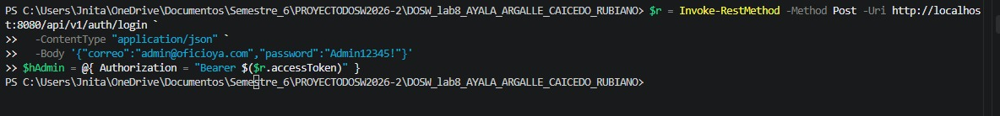
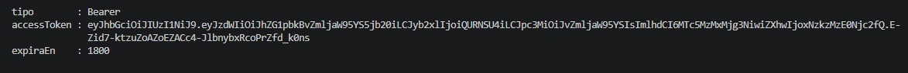

- Registro de Trabajor y Contratante
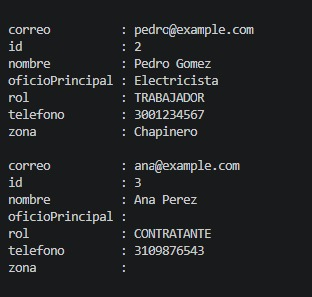

- endpoints con el token del ADMIN.
Mi perfil: Traer correo y telefono
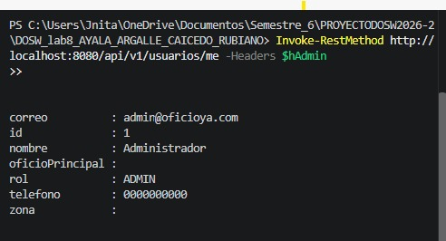

Lista de trabajadores: solo Pedro, SIN correo ni telefono
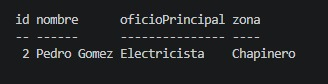

Trabajador por id (el de Pedro, normalmente 2)
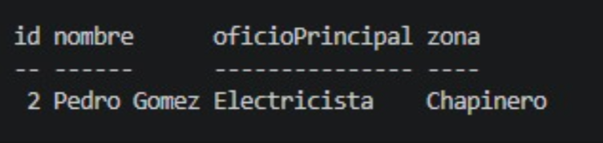

Admin: los 3 usuarios CON correo y telefono
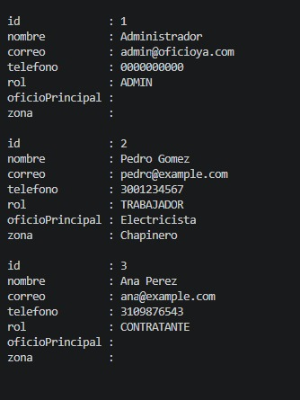

- Pruebas durabilidad token

Login de Pedro (trabajador)
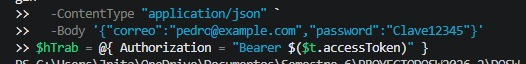

Trabajador en /admin/usuarios: debe dar 403
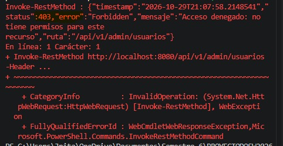

Trabajador en su propio perfil:funciona
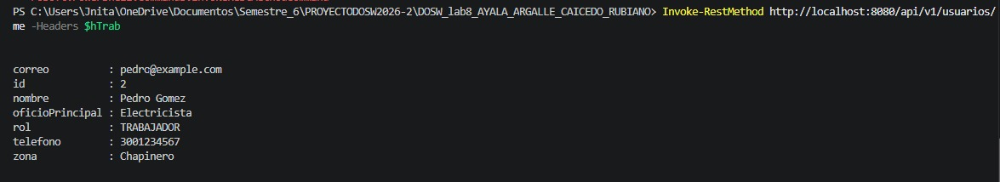

Id que no existe: debe dar 404
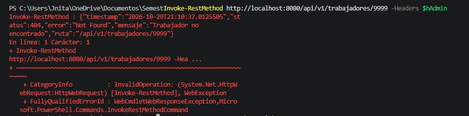

Id de Ana, que no es trabajadora: debe dar 404
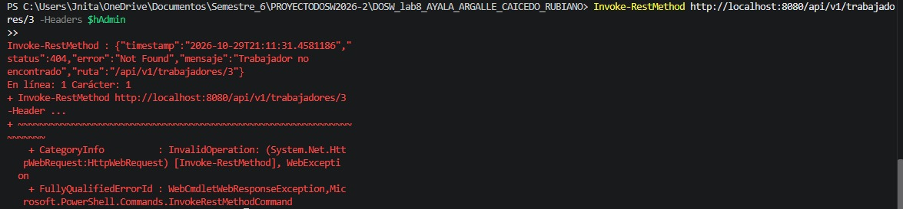

Sin token: debe dar 401
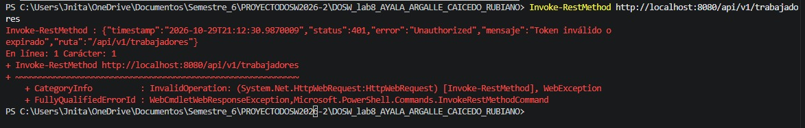

